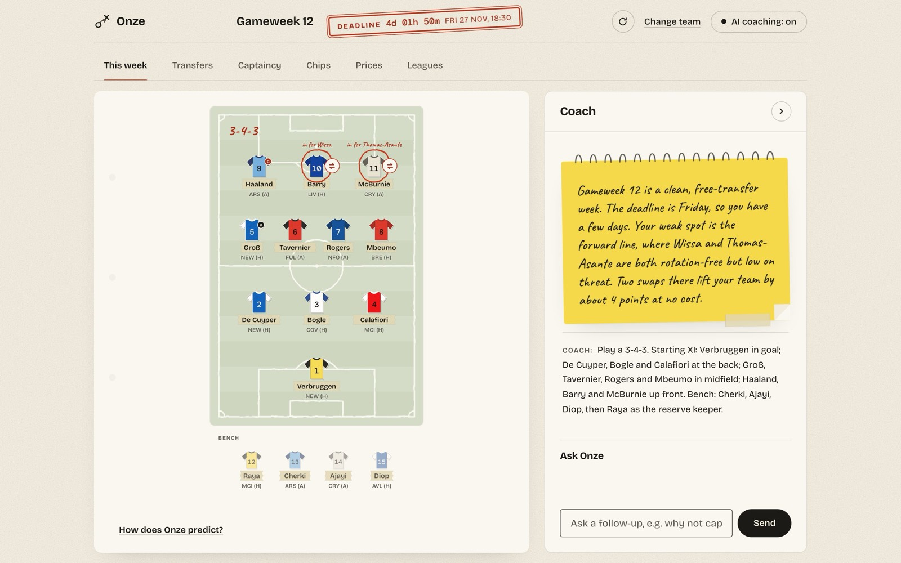
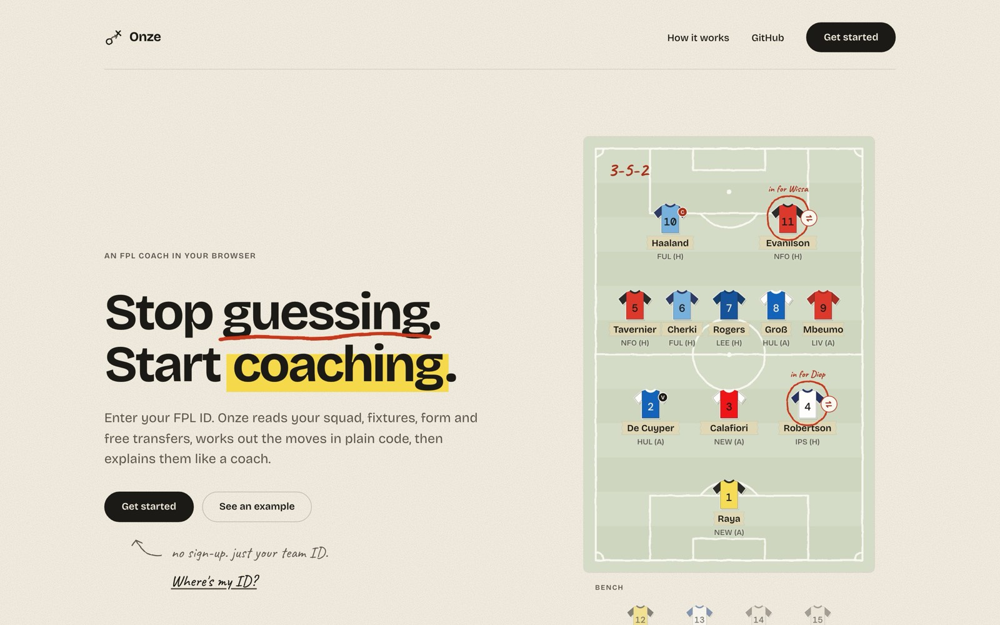
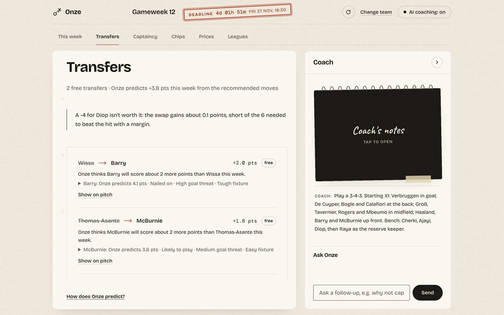
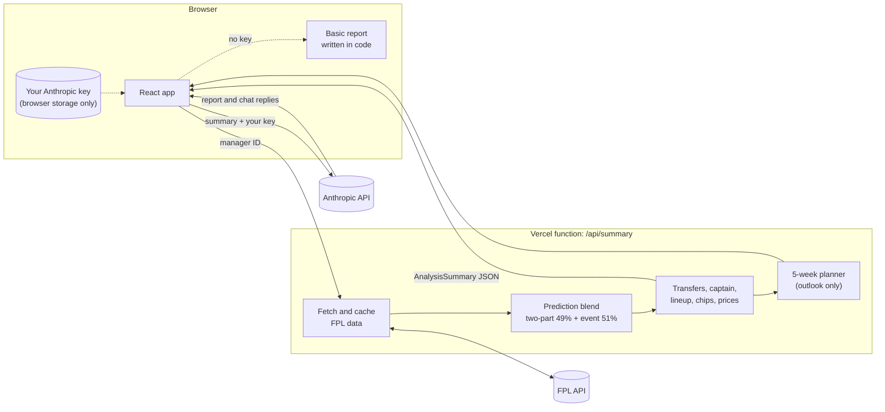

# onze

**An AI coach for Fantasy Premier League that does the maths in code and explains it like a coach.**

[](https://github.com/chukwuemekaorji/onze/actions/workflows/ci.yml)
[](./LICENSE)

**Live:** [onze.chukwuemekaorji.xyz](https://onze.chukwuemekaorji.xyz) · [See an example](https://onze.chukwuemekaorji.xyz/app?example) (no FPL team needed)



<table>
  <tr>
    <td width="50%"></td>
    <td width="50%"></td>
  </tr>
  <tr>
    <td align="center">Landing page</td>
    <td align="center">Transfers</td>
  </tr>
</table>

## What it does

- **Reads your team.** Enter your FPL ID and onze pulls your squad, bank, free transfers, fixtures and mini-leagues from the official FPL API.
- **Predicts every player's points** with its own model, tested on a full season it never saw, and uses FPL's injury news.
- **Makes the calls:** which transfers to make (and whether a -4 hit is worth it), who to captain, your best eleven and bench order, when to play a chip, and which prices are about to move.
- **Explains them like a coach.** An AI model turns the numbers into a short written report in plain football language, with no stats jargon.
- **Answers follow-up questions** in a chat grounded in the same data, so "why not captain Salah?" gets an answer about your team, not a generic one.

## Results

Every number below comes from the files in [`results/`](./results), each written by a script and scored once.

### The prediction model beats the usual rules of thumb on a season it never saw

The model was built on 2023-24 and 2024-25. Then it was frozen and scored on all 38 gameweeks of 2025-26 (29,338 player-gameweeks), a season it had never seen.

| How players are picked     | Top-5 picks, average points | Captain, average points | Share of 10+ point hauls on its top-20 shortlist |
| -------------------------- | --------------------------- | ----------------------- | ------------------------------------------------ |
| **onze (the blend)**       | **5.23** [4.67, 5.87]       | **6.21** [4.76, 7.76]   | **19%** [16%, 22%]                               |
| Form (last 30 days)        | 4.08 [3.44, 4.76]           | 4.75 [3.47, 6.20]       | 13% [10%, 15%]                                   |
| Points per game            | 4.12 [3.54, 4.72]           | 5.06 [3.44, 6.83]       | 13% [10%, 16%]                                   |
| Last 3 gameweeks           | 4.28 [3.68, 4.92]           | 4.34 [3.02, 5.78]       | 13% [10%, 16%]                                   |

"Top-5 picks" is the average real score of the five players the method rated highest each gameweek. Brackets are 95% bootstrap intervals over gameweeks. Full tables: [`results/test-2025-26.md`](./results/test-2025-26.md).

### Its decisions beat chasing form by 138 points a season

A backtest played three whole seasons (2023-24 to 2025-26) deadline by deadline, under FPL's real rules: £100m budget, three players per club, rolling free transfers, -4 hits, auto-subs, real price changes and FPL's selling price. It started from the same 20 squads each season and compared transfer strategies built from the app's own code.

| Strategy, season points after hits | Average a season | Hits a season |
| ---------------------------------- | ---------------- | ------------- |
| onze's one-week advice             | 2104             | 0.1           |
| Chasing form                       | 1966             | 14.7          |
| No transfers                       | 1576             | 0             |

onze's advice finished **+138 points a season ahead of chasing form, 95% interval [+63, +215]**, and +529 [+461, +598] ahead of making no transfers. A big part of the gap is discipline: chasing form took 14.7 hits a season, which cost about 58 points; onze took 0.1. Full tables: [`results/decision-backtest.md`](./results/decision-backtest.md).

### The AI writing is checked against the data

Fifteen golden scenarios, built from real FPL data (a blank gameweek, a double gameweek, an injured captain, a hit that pays, five banked transfers and more), run through the real prompt. Every reply is checked in code:

- **Faithfulness:** every number and every player name in the reply must trace back to the data the coach was given.
- **Wording:** plain language, no jargon, no FPL figures passed off as onze's, and the 5-week outlook in one sentence at most, never as this week's advice.
- **Structure:** the reply parses into the exact shape the app renders.

**15 of 15 pass every check**, and CI rechecks the saved replies on every push. The evals also found a real production bug: the first live run showed every report was being cut off at the token limit. The app now asks for less hidden reasoning, has room for a full report, and shows a clear error instead of a truncated one.

### Things that didn't work

These are reported here as plainly as the wins.

- **The event model didn't beat the simpler model on its own.** Modelling each scoring event (goals, assists, clean sheets, saves, bonus) was not clearly better than the two-part model, either on the tune seasons or on 2025-26. Blending the two was better on the tune seasons, so the blend ships. On 2025-26 it was clearly better only at catching hauls, and level on top-5 picks and captaincy.
- **The 5-week planner lost on the held-out season.** Averaged over three seasons it was +29 points a season ahead of the one-week advice (not a clear difference). But on 2025-26, the only season played with the weights the app actually runs, it was clearly worse: -74 points [-131, -14]. So the one-week logic gives this week's advice and the planner is shown only as a "Looking ahead" outlook.

## How it works



The server only does data. It takes a manager ID, fetches what it needs from FPL, predicts every player's points, runs the decision logic and returns one JSON summary. It never calls Anthropic. The browser does the writing: with your key it sends the summary straight to the AI model, and without one it writes a basic report in code. The model never computes anything; it explains decisions that were already made, and every number it may quote is in the summary.

### The two models, in plain words

onze predicts a player's points as **the chance he plays, times the points he'd score if he does**, using two different methods and averaging them.

- **The two-part model** looks at how often a player has started and come on lately, then predicts his points if he plays from his points this season, his recent form, his goal involvement, his price, whether he's at home and how strong the opponent is.
- **The event model** predicts each way of scoring separately (goals, assists, clean sheets, goals conceded, saves, bonus, defensive contributions), based on his own rates, his team's and the opponent's expected goals, and then adds them up with FPL's scoring rules.

Both start each season from last season's numbers and shift toward this season's as matches are played. Both read FPL's injury and suspension news for the chance of playing.

**Technically:** the two-part model is a logistic regression for P(plays) times a ridge-penalised linear model for points given an appearance. The event model uses Poisson rates per 90 minutes, shrunk toward a league prior, with team attack and defence strength from expected goals. The blend weight is 0.4892 on the two-part model, the least-squares weight fitted out of fold on the two tune seasons, and is never refitted. The weights and last season's prior stay on the server; only the predictions reach the browser. The code is in [`lib/analysis/projection.ts`](./lib/analysis/projection.ts), [`lib/analysis/event-projection.ts`](./lib/analysis/event-projection.ts) and [`lib/build-projections.ts`](./lib/build-projections.ts).

The design, the data pipeline and the main decisions are written up in [`docs/design.md`](./docs/design.md).

## Evaluation method

The aim was numbers that hold up, not numbers that look good.

- **Pre-registered rules.** Before the test season and the backtest were run, the rule for what would count as a win was written into the results file and fixed by a hash. A run whose rule differs from the registered one refuses to start.
- **Leak-proof history.** A model predicting gameweek N is handed a frozen view of earlier gameweeks and earlier seasons only, plus the player, price and fixtures for N. It never sees the result, and the rows are frozen so it can't edit history either.
- **Out-of-fold weights.** In the backtest's tune seasons, each season is played with weights fitted on the other one, so no season is scored with weights that saw it.
- **A test season scored once, enforced in code.** 2025-26 is locked: tuning code throws if it tries to read it, and the final scoring script refuses a second run once the results are written.
- **Bootstrap confidence intervals.** Every figure carries a 95% interval from 2,000 resamples of whole gameweeks, so the luck of a good or bad week is in the error bars.
- **Paired comparisons.** Two models or strategies are compared on the same resampled gameweeks and the same start squads, so shared luck cancels and the interval is on the difference itself.

## Your key stays yours

onze is bring-your-own-key. The site has no Anthropic key and no server that could see yours.

- **Browser to Anthropic, directly.** Your key is kept in your browser's session storage (cleared when the tab closes) or, if you tick "remember", local storage. It is sent only to `api.anthropic.com`. The server's one endpoint takes a manager ID and nothing else.
- **Nothing stored server-side.** No database, no accounts, no logs of keys or chats. Your chat history lives in your browser and is sent with each question.
- **A tight Content Security Policy.** Scripts and styles load only from the site itself, with no inline code. The page can connect only to itself and to Anthropic. So even if something injected markup into the page, it couldn't run a script or send your key anywhere else. The model's replies are escaped before they're rendered.
- **Analytics without tracking you.** onze uses cookieless, first-party Vercel Web Analytics, with no personal data and no third-party scripts.
- **Guarded in CI.** A lint rule fails the build if the app's code ever reads an Anthropic key from the environment.

**Why the request says "dangerous-direct-browser-access".** Anthropic's API refuses calls from a browser unless the request carries the header `anthropic-dangerous-direct-browser-access: true`. The name is a warning to developers not to put their own key in a public web page, where any visitor could read it and spend it. onze does the opposite: the key belongs to the person using the page and goes from their browser to Anthropic only. That is the case the header is there for. For extra peace of mind, use a key from a separate workspace with a monthly spend limit.

Without a key you still get the full analysis and a basic written report; only the AI report and chat need one.

## Tech stack

- **Language:** TypeScript everywhere, in strict mode.
- **Frontend:** React 19 and Vite, with Motion for animation (respecting reduced-motion settings) and self-hosted fonts.
- **Backend:** one Vercel serverless function (`api/summary.ts`) and a small in-memory cache of FPL responses.
- **AI:** the Anthropic Messages API, called from the browser.
- **Testing:** Vitest, ESLint and Prettier, run in GitHub Actions on every push.
- **Data:** the official FPL API for the live app, plus the vaastav archive for past seasons.

## Run it locally

You need Node 22 and npm.

```bash
git clone https://github.com/chukwuemekaorji/onze.git
cd onze
npm ci
npm run check   # typecheck, lint, formatting, tests and the production build
```

To run the full app, with the `/api/summary` function serving real FPL data:

```bash
npm start       # runs vercel dev; the first run asks you to log in to Vercel and link the folder (a free account works)
```

To look at the interface only, without a Vercel account, use Vite and open the bundled example team at `http://localhost:5173/app?example`:

```bash
npx vite
```

No environment variables are needed. Add your Anthropic key in the app to turn on the AI report and chat.

### Reproduce the results

The evaluation scripts need the historical dataset, which is downloaded rather than committed:

```bash
npm run data:build        # past seasons from vaastav at a pinned commit, this season from FPL, into data/ (gitignored)

npm run eval:baselines    # form, points per game, last 3 and others on the tune seasons
npm run eval:projection   # fit and score the two-part model (rewrites its weights file)
npm run eval:events       # fit and score the event model
npm run eval:ensemble     # the blends against the two-part model
npm run eval:test:rehearse  # dry run of the final test on a tune season
npm run backtest:rehearse   # dry run of the decision backtest on one tune season
```

The scripts that fit or score rewrite their files in `results/` and `lib/analysis/`, so `git diff` shows whether you got the same numbers. The final test (`npm run eval:test`) and the backtest (`npm run backtest`) refuse to run a second time: their results are already recorded.

The AI evals run in every `npm test`, against the model's saved replies in `test/fixtures/golden/replies/`. To get fresh replies, set `ANTHROPIC_API_KEY` in your shell and run `npm run eval:live` (add `-- --failing` to redo only the replies that fail a check). It prints the most it can cost and asks before making any paid call.

## Limitations and what's next

**Limitations**

- FPL's price-change algorithm is not public. Price alerts flag heavy buying and selling and moves that have already happened; they are signs, not predictions of tonight's change.
- The historical archive has no team news, so the backtest saw injuries only through missing minutes. The live app does use FPL's news.
- The backtest plays no chips, and three seasons is a small sample: the intervals cover week-to-week luck, not how different another season might be.
- Defensive contribution points started in 2025-26 with no history behind them, so the model underrated them in that season.
- The chat only knows what is in your report's summary. It can't look up a player outside it.
- onze relies on FPL's unofficial public API, which can change without notice.

**What's next**

- **A tool-using coach:** let the chat look up any player, fixture or "what if" transfer through tools, rather than only the summary.
- **Saved preferences:** your appetite for risk, chip plans and players you won't sell, remembered in your browser.
- **A public track record:** log each week's advice before the deadline and score it against what actually happened.

## Data and credits

- Past seasons come from [vaastav/Fantasy-Premier-League](https://github.com/vaastav/Fantasy-Premier-League) (MIT), pinned to one commit so the results can be reproduced.
- Live data comes from the official Fantasy Premier League API.
- The data belongs to the Premier League / Fantasy Premier League and to Understat.

onze is not affiliated with the Premier League or Fantasy Premier League.

## Author

Built by [Chukwuemeka Orji](https://chukwuemekaorji.xyz).

## License

[MIT](./LICENSE)
