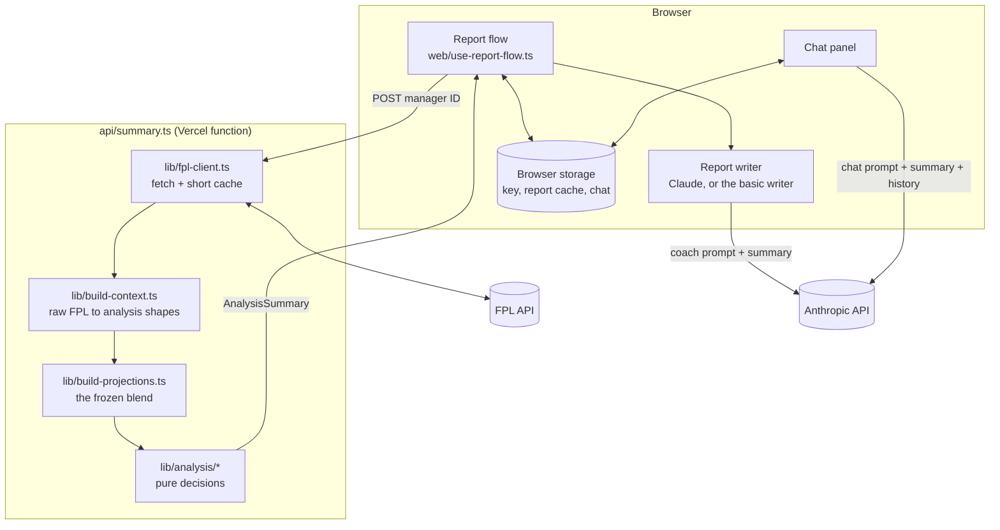

# Onze: design

This document describes how Onze is built, how its numbers are produced and checked, and why the main decisions went the way they did. The [README](../README.md) covers what it does and the headline results.

## The product in one paragraph

A Fantasy Premier League manager enters their FPL ID. Onze fetches their team and the game's data, predicts every player's points for the coming gameweeks, decides the week's transfers, captain, lineup, chip timing and price risks, and returns all of it as one structured summary. Claude turns that summary into a short coaching report and answers follow-up questions about it. Users bring their own Anthropic key. Without one they still get the full analysis and a basic report written in code, but no chat.

## Architecture

### Server: data only

`POST /api/summary` is the only endpoint. Given a manager ID it:

1. Fetches the game's bootstrap data, the fixture list, the manager's entry, picks and history, and one `/event/{gw}/live/` call per past gameweek, which together give the season so far for every player and team.
2. Builds plain analysis shapes from the raw FPL responses (`lib/build-context.ts`, `lib/build-match-history.ts`).
3. Predicts every player's points with the frozen blend (`lib/build-projections.ts`), with FPL's injury and suspension news applied to the chance of playing.
4. Runs the pure decision modules in `lib/analysis/` and returns an `AnalysisSummary`.

The bootstrap, the fixtures and the per-gameweek live data are cached in memory for 10 minutes; those are the expensive calls, and nothing else is cached. Errors (FPL down, unknown manager, rate limits) map to clear HTTP statuses and messages in `lib/fpl-error-response.ts`.

The server never calls Anthropic and never sees a user's key.

### The decision modules

Everything in `lib/analysis/` is pure: typed data in, typed data out, with no network, logging or environment access. That keeps the maths testable and lets the backtest reuse the exact code the app runs.

- **Transfers** (`transfers.ts`): finds the squad's weak links over the next few gameweeks, searches the player pool for affordable replacements that respect the three-per-club rule, and decides how many moves are worth making this week. It weighs each move's predicted gain against the free transfers banked (simulated from the manager's history, since FPL doesn't expose the count) and only takes a -4 hit when the gain clears it by a margin.
- **Captaincy** (`captaincy.ts`) and **lineup** (`lineup.ts`): the best eleven in a legal formation, bench order, captain and vice-captain, all from the predictions, and assuming the recommended transfers are made.
- **Chips** (`chips.ts`): finds double and blank gameweeks in the fixture list and the squad's exposure to them, and suggests when a chip has a real case.
- **Prices** (`price-alerts.ts`): flags prices that have already moved this gameweek and players being heavily bought or sold. FPL's price algorithm is not public, so these are always presented as signs, not predictions.
- **Planner** (`planner.ts`): a beam search over the next five gameweeks, with free-transfer rollover, hits, bank, three per club, and the best eleven and captain each week. Its first week is pinned to the one-week advice, so it can never contradict it. It is shown as a "Looking ahead" outlook only (see the decisions below).

### Browser: the writing

- **With a key**, `web/report-writer.ts` sends the summary to Claude with the coach prompt (`lib/coach-prompt.ts`) and parses the reply into fixed sections: summary, transfers, captaincy, chips, price alerts and formation. If the call fails (bad key, rate limit, no credit, a reply cut off or unreadable), the user sees the error and the basic report, labelled "Basic report (no AI)". Nothing is swapped in silently.
- **Without a key**, `lib/fallback-writer.ts` writes the basic report locally from the same summary.
- **Chat** sends the summary, the latest 20 messages and the new question with the chat prompt (`lib/chat-prompt.ts`). The conversation is saved in local storage per manager and gameweek, and dropped when the deadline passes or the report is regenerated with new data.
- **One voice.** The coach's persona lives in `lib/persona.ts` and both prompts import it.
- **One vocabulary.** Every label a user reads ("Onze predicts 5.4 pts", "Nailed on", "High goal threat", "Easy fixture") and its threshold comes from `lib/plain-labels.ts`. The UI, the basic report and both prompts use it, so the coach and the screen never disagree on what "likely to play" means.

The finished report is cached in the browser per manager and dropped once the gameweek deadline passes.

## The prediction

Onze predicts each player's points as the chance he plays times the points he'd score if he plays, summed over his fixtures in the gameweek (a double gameweek has two, a blank none).

- **Two-part model** (`lib/analysis/projection.ts`): a logistic regression for the chance of playing (recent starts and appearances, season appearances, price) times a ridge-penalised linear model for points per appearance (position, season points, form, last three, attacking returns, price, fixture difficulty, home or away). It has few weights on purpose, so each can be read and explained.
- **Event model** (`lib/analysis/event-projection.ts`): the same chance of playing, times each scoring event's expected count (goals, assists, clean sheets, goals conceded, saves, bonus, defensive contributions) run through FPL's scoring rules. Rates are per 90 minutes and shrunk toward a league prior; team attack and defence strength come from expected goals (`team-strength.ts`).
- **The blend**: 0.4892 x two-part + 0.5108 x event (`blend-weight.ts`). The weight was fitted out of fold on the tune seasons before the test season was opened, and it is never refitted.
- **Defensive contributions**, new in 2025-26, are a rule-based term on top of both models (2 points at 10 for defenders, 12 for midfielders and forwards), not fitted.
- **Last season's prior** (`lib/projection-prior.ts`) is generated each summer with `npm run data:prior`. Each player and team starts from it and moves toward this season's numbers as matches are played.

The weights and the prior are server-only. The browser gets predictions, never the model.

## Data and evaluation pipeline

### Data

- **Past seasons** come from the [vaastav/Fantasy-Premier-League](https://github.com/vaastav/Fantasy-Premier-League) archive, pinned to one commit so every result can be reproduced. **The current season** comes from the FPL API.
- `npm run data:build` downloads both and normalises them into one typed shape (`lib/dataset/`), written to `data/derived/`, which is gitignored.
- **The seasons are split before any result is looked at** (`lib/eval/splits.ts`):
  - 2022-23 is history only;
  - 2023-24 and 2024-25 are the tune seasons;
  - 2025-26 is the locked test season;
  - 2026-27 is live.

### Scoring a model

`lib/eval/` holds the harness; `scripts/eval/` runs it and writes `results/*.md`.

- **History views.** For each gameweek, a model gets a frozen view of earlier gameweeks and earlier seasons, plus the targets (player, price, fixtures), never the outcome.
- **Metrics:**
  - average real points of the top 5 predicted;
  - captain regret (the best real score among the top 20 predicted, minus the top pick's);
  - share of 10+ point hauls on the top-20 shortlist;
  - error and rank correlation.
- **Intervals.** Every metric has a 95% bootstrap interval over 2,000 resamples of whole gameweeks. Model comparisons are paired: both are scored on the same resampled gameweeks and the interval is on the difference.
- **Baselines:** form, points per game, last three gameweeks and a constant. FPL's own expected points are shown but flagged as leaky, since the archive's figure may have seen team news or the result.
- **Decision rules** are written into the generating script before the run, so a verdict is computed rather than written by hand.

### The test season

- **Registration.** `npm run eval:test:register` writes the rule and the blend weight into `results/test-2025-26.md`, fixed by a hash, before 2025-26 is loaded.
- **Scoring.** `npm run eval:test` scores it once. It refuses if the rule changed, and refuses a second run.
- **Locked in code.** Tuning code that asks for 2025-26 throws `LockedSeasonError`.

### The decision backtest

`lib/backtest/` plays whole seasons forward, deadline by deadline, under FPL's rules:

- the budget and three per club;
- free transfers rolling over to five;
- hits, auto-subs, and the vice-captain stepping in;
- real price changes, and FPL's selling price (half of any rise, rounded down).

It compares transfer strategies built from the app's own code, from the same 20 start squads per season:

- no transfers;
- chasing form;
- Onze's one-week advice;
- the planner.

Tune seasons are played with out-of-fold weights; 2025-26 with the frozen production weights. The rule is registered by hash (`npm run backtest:register`), a rehearsal runs on one tune season only, and `npm run backtest` plays every season once and refuses to run again.

### The AI evals

`lib/eval/llm/` checks a coach reply against the summary it was given:

- **Faithfulness:** each number and player or club name must appear in the summary, within the rounding the prompt allows.
- **Wording:** no jargon from `plain-labels.ts`, no "expected points" or FPL's figures presented as Onze's, no closing question, and the outlook in one sentence at most and never as this week's advice.
- **Structure:** the reply parses into the exact JSON shape.

The golden set (`test/fixtures/golden/`) has 15 scenarios built from real FPL data by `npm run eval:golden`, with named edits and anonymised managers. CI checks the basic report for every scenario and every saved Claude reply. `npm run eval:live` asks Claude for fresh replies with the real prompt and model, after printing the most it can cost and asking to confirm. It is run by hand and never in CI.

When a check finds a real problem in a reply, the prompt is fixed, not the check. When a check is wrong (a false positive), it is fixed with a test that the correct case passes and a matching wrong case still fails.

## Key decisions

### Bring your own key

The site holds no Anthropic key. Users paste their own, kept in session storage by default or local storage if they choose "remember", and the browser calls Anthropic directly.

- **Cost:** a free public site can't absorb unbounded model spend, and a shared key invites abuse. With BYOK, each person pays for their own usage, and the analysis is free for everyone.
- **Trust:** the key never touches the server, so there is nothing server-side to leak, log or subpoena.
- **Safety in the page:** a strict Content Security Policy allows no inline scripts or styles, no third-party code, and connections only to the site and `api.anthropic.com`. Model output is escaped before it reaches the page. These protect a stored key from injected markup.
- **The browser header:** browser calls need the `anthropic-dangerous-direct-browser-access` header. It warns against shipping a developer's own key in a page; here the key is the visitor's own, which is the case it exists for.
- **Guarded in CI:** a lint rule fails any code in the app that reads `ANTHROPIC_API_KEY`. The one exception is the developer-only `eval:live` script.

### No database

There are no accounts, no sessions and no server state. A manager ID is public, so it needs no login. The report cache and the chat history live in the browser and travel with each request. This keeps the app free to host, means there is no personal data to protect on the server, and removes a whole class of failures. The cost is that history doesn't follow a user across devices, which is acceptable for a weekly tool.

### The blend over the two-part model alone

The event model on its own did not beat the two-part model: no clear difference on captain regret or top-5 picks in the tune seasons, and none on 2025-26 either.

The blend, though, passed a pre-registered rule on the tune seasons: clearly better on top-5 picks and clearly worse on nothing. On the locked test season it passed the rule set for shipping: clearly better at catching hauls (+2.4 percentage points [+0.8, +4.5]) and not clearly worse on top-5 picks or captaincy.

So the blend ships, with its weight frozen at 0.4892. A per-position weight was tried and did not clearly beat the single weight, so it was dropped.

### One-week advice over the planner

The backtest's pre-registered rule said the planner would become the main advice if it was not clearly worse than the one-week logic. Averaged over three seasons it wasn't: +28.8 points a season [-16.3, +72.8].

But that average hides the result that matters most. 2025-26 is the only season played with the frozen production weights and with no data the models had seen. There the planner was clearly worse: -73.5 points a season [-131.2, -14.2]. Its advantage came entirely from the tune seasons.

So the decision deviated from the rule. The one-week logic stays the single source of this week's advice. The planner is shown as a five-week outlook that starts from that advice, in at most one sentence in the coach's report.

The lesson, recorded with the result: future rules give the out-of-sample season priority. A change should not ship if it is clearly worse there, whatever the average says.

### Code decides, the model explains

Claude never computes a number or makes a call. Transfers, captaincy, lineup and hits are decided in tested code, and the prompt hands Claude the results, the plain labels and ready-made sentences. This keeps the advice reproducible and testable. It also makes the faithfulness check possible: if every number must come from the summary, any invented figure is caught.

## Testing

- **Unit tests.** Every function in `lib/analysis/` has a normal case, an edge case (no fixtures, a blank gameweek) and a bad-input case.
- **Browser modules.** Modules that use `fetch` or storage are tested with those stubbed, never against the real Anthropic API.
- **One command.** `npm run check` runs the typecheck, lint, formatting, tests and the production build. CI runs it on every push and pull request.
